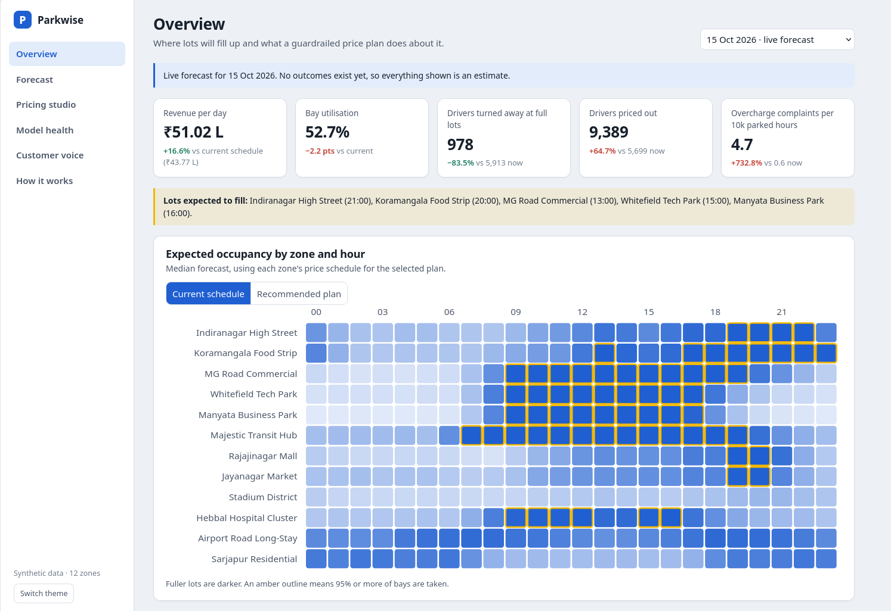
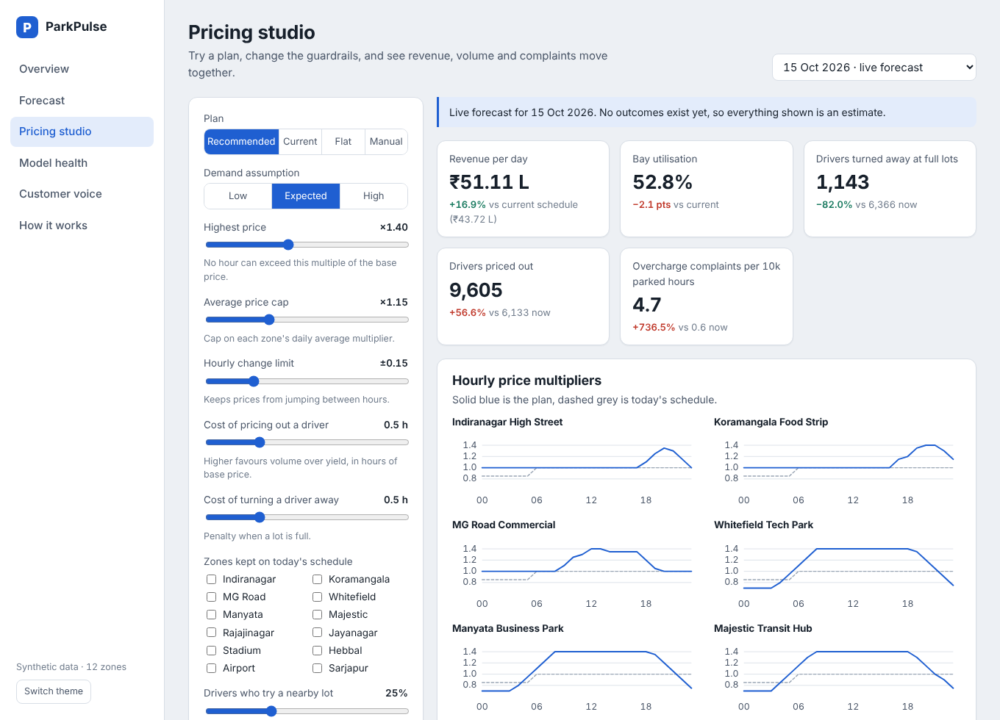
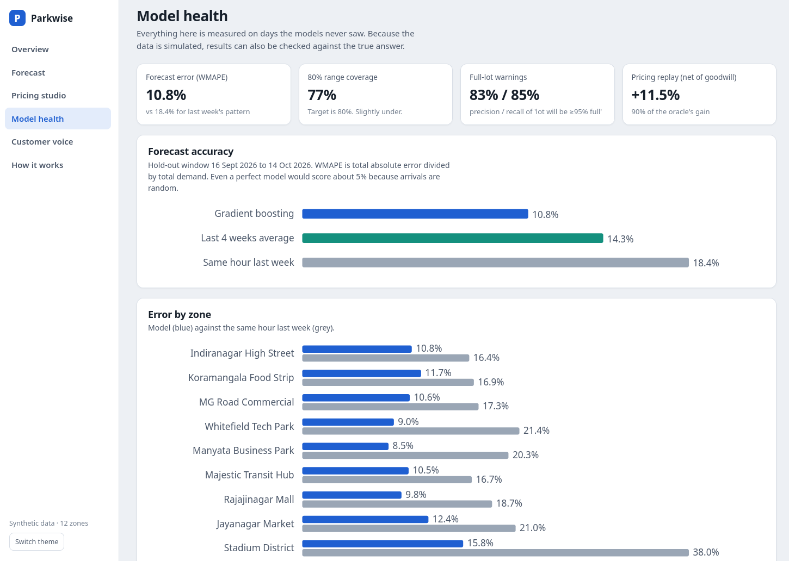

# Parkwise

**[Live Demo](https://parkwise-xeoq.onrender.com/) · [Product Brief](PRODUCT.md)**
**Parking demand forecasting and guardrailed dynamic pricing, end to end.**
A day-ahead forecaster, a price-sensitivity estimator built on randomised experiments, a constrained
pricing optimiser, a ticket classifier, and a dashboard. All of it runs offline with no API keys.

**Product brief:** [Metrics, rollout plan, and risks → PRODUCT.md](PRODUCT.md)



<p> </p>

> **Key product decision:** The first optimizer increased simulated revenue by 18%, but priced out too many drivers. Therefore, added a goodwill cost for turned-away and priced-out drivers, accepting a +13% revenue improvement in exchange for a more balanced outcome.
> **All data is synthetic.** Real parking telemetry is proprietary, so a simulator with *known* demand
> and price sensitivity generates the data. That is a feature as well as a limit: it lets every stage be
> graded against the truth, which real data never allows. See [Limitations](#limitations).

## Results

All numbers are measured on 29 held-out days (16 Sep to 14 Oct 2026) that no model saw. Reproduce with
`make build && make evaluate`.

| Question | Result |
|---|---|
| Does the forecast beat naive baselines? | WMAPE **10.7%** vs 14.3% (4-week average) and 18.4% (same hour last week) |
| Is the uncertainty honest? | 80% interval covers **76.7%** (a little under target; reported, not hidden) |
| Can ops be warned about full lots? | **83% precision / 86% recall** for "will be 95%+ full" (naive: 70% / 76%) |
| Is price sensitivity recovered? | **12 of 12** true values inside their 95% intervals, mean absolute error 0.05 |
| Does pricing help? | Revenue **+13.0%** (95% CI +11.9% to +14.0%) vs the static schedule; **+11.5%** net of goodwill cost, **90%** of what an oracle achieves |
| What does it cost? | Drivers turned away **-66%**, but drivers priced out **+75%** and utilisation **-2.2 pts**. The trade-off is shown, not hidden |
| Does the text model work? | Ticket macro-F1 **0.89** vs 0.69 for keyword rules (on noisy, partly Hinglish tickets) |

## Run it

```bash
pip install -r requirements-dev.txt
python -m parkwise serve          # http://127.0.0.1:8000  (artifacts/ is included)
python -m parkwise build          # regenerate everything (~2 min)
python -m unittest discover -s tests -t .   # 41 tests, ~6 s
```
Tested with Python 3.13. The application runs locally without API keys.

## How it works

```
 generator.py ──► hourly.csv.gz ─┬─► elasticity.py ──► beta (price sensitivity, per zone)
 (hidden truth)   events.csv     │
                                 ├─► features.py ──► forecast.py ──► p10 / p50 / p90 demand at base price
                                 │    (leakage-safe)  (GBM + CQR)            │
                                 │                                           ▼
                                 │                                   pricing.py (DP optimiser + simulator)
                                 │                                           │
                                 └─► tickets.py ──► complaint curve ─────────┤
                                                                             ▼
                              pipeline.py (build + grade) ──► artifacts/ ──► service.py ──► api.py ──► dashboard
```

- **Demand curve.** `demand(m) = d0 · capacity · exp(beta · (m − 1))`. Elasticity is `beta · m`, so drivers get
  more price-sensitive as price climbs and the revenue-maximising price is finite.
- **Forecast target is demand at the base price**, not occupancy. History gathered under different prices
  is "deflated" to one scale, so the optimiser can ask "what happens at multiplier m?" of one clean number.
- **Optimiser.** Per zone, dynamic programming over 24 hours maximises
  `revenue − turn_cost · turned away − deter_cost · priced out`, subject to bounds on any hour's price, the
  hour-to-hour change, and the daily average (a Lagrange multiplier found by bisection).
- **Serving.** Forecasts are a nightly batch job stored as arrays; the API combines them with the demand
  curve and optimiser in milliseconds.

## Decisions worth discussing

1. **Censored demand.** A full lot hides demand. Estimating price sensitivity from occupancy understates it
   exactly where it matters (Koramangala: -0.72 naive vs -1.00 true). The estimator uses arrivals
   (occupied + turned away) instead. Both are on the Model health page.
2. **A confounder I found by testing.** My first estimator was biased and its intervals covered only 81%.
   The operator's weekend surcharge also applies on weekday holidays, and holidays shift demand, so
   hour-of-week cells mixed two regimes. Adding the off-day regime to the fixed effects fixed it (96%
   coverage over 8 seeds). A test now guards the no-experiment case too.
3. **Pure revenue maximisation quietly sacrifices volume.** The first optimiser lifted revenue 18% by pricing
   out many drivers. It now includes a goodwill cost for turned-away and priced-out drivers, exposed as a
   growth-versus-yield dial, and defaults are conservative (average price cap +15%).
4. **Customers as a guardrail.** Overcharge complaints are about 0.65 per 10k parked hours at a normal price
   and 4.9 at +25% (7.6x). A fitted complaint model projects this for every plan in the studio.
5. **Leakage is tested, not assumed.** A test corrupts every outcome from day D onward and asserts day D's
   features are unchanged; another proves the test can fail. A third checks that modelling code never
   imports the hidden ground truth.
6. **Honest ablations.** History features matter (+1.7 pts error when removed); weather and holiday flags
   barely do. The dashboard shows both refit-ablation and permutation importance and why they differ.
7. **Cold start has a boundary.** For a new lot whose area mix exists elsewhere in the network, median error
   is 21% vs 40% for a blind average. Lots with a unique archetype (airport, hospital) are *not* helped.

## Limitations

- Results come from a simulator. Real data adds reporting gaps, behaviours not modelled here, and
  non-constant price sensitivity. The first real step would be a small randomised pilot.
- The pricing replay is an expected-value simulation against the hidden truth, not an A/B test.
- Spillover to nearby lots is an assumption (25%). Results move only +12.8% to +13.2% across 0-50%.
- Weather "forecasts" are true weather plus modelled error. Ticket text comes from a small template set, so
  real tickets would score lower than 0.89.
- The 80% interval undercovers slightly (76.7%). It is calibrated on a single one-month window; a production
  system would recalibrate on a rolling window.
- Gradient boosting here is scikit-learn's `HistGradientBoostingRegressor` (same family as LightGBM), chosen
  so the project has no hard dependency on extra packages.

## API

| Method | Path | Purpose |
|---|---|---|
| GET | `/api/health` | liveness and artifact status |
| GET | `/api/meta` | zones, dates, guardrail defaults, assumptions |
| GET | `/api/overview?date=` | network KPIs, heatmap, per-zone recommendations |
| GET | `/api/forecast?zone_id=&date=` | hourly forecast with 80% band (and actuals in backtest) |
| POST | `/api/simulate` | what-if plan under guardrails; validated body, `422` with field errors |
| GET | `/api/history?zone_id=` | daily utilisation and revenue |
| GET | `/api/report` | model health, elasticity, policy replay, ticket classifier |

```bash
curl -s localhost:8000/api/simulate -H 'content-type: application/json' \
  -d '{"date":"2026-10-15","guardrails":{"max_mult":1.3,"avg_cap":1.1},"locked_zones":[3,4]}'
```

## Layout

```
parkwise/  config  generator  elasticity  features  forecast  pricing  tickets  pipeline  service  api  static/
tests/      simulator, estimator vs truth, leakage, optimiser guardrails, simulator laws, API contract, report guards
artifacts/  built outputs (data, models, report.json)
PRODUCT.md  the product brief: metrics, rollout plan, risks
```
